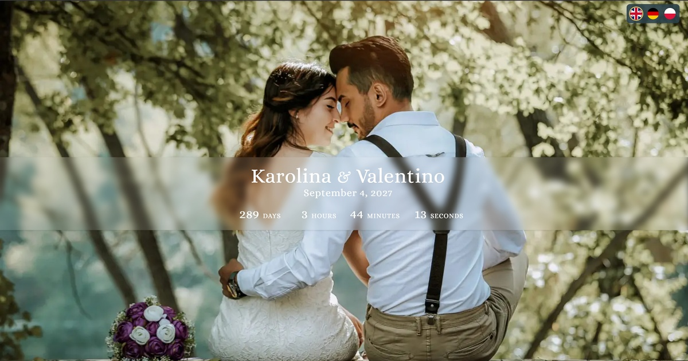

# Wedding Website

**[www.wedding.lukaszsliwinski.pl](https://www.wedding.lukaszsliwinski.pl)**

## About the project

A multilingual website created for my friends' wedding, with event details and practical information about Poland for guests from abroad. Its visual design is consistent with the printed wedding invitations, and the interface was created without UI component libraries. The site is available in English, German and Polish, opens with an animated intro and a live countdown to the ceremony, and loads the map only after a click to respect visitors' privacy. Names and personal details have been changed, and the photos come from [Pixabay](https://pixabay.com) (Pixabay Content License).

## Technologies

**Frontend**

- **Next.js 16 (App Router)** – static prerendering of every language version, plus image and font optimization
- **React 19 and TypeScript** – typed components and data
- **next-intl** – translations in three languages, with plural forms and rich text
- **Tailwind CSS 4** – styling and responsiveness, with a theme based on CSS variables
- **Motion** – intro animation and animated elements that appear on scroll
- **Google Maps Embed** – venue map loaded only after the visitor's consent

**Deployment**

- **Docker** – multi-stage build, Next.js standalone mode, container running without root privileges
- **Traefik** – reverse proxy with domain routing, TLS certificate and HSTS header
